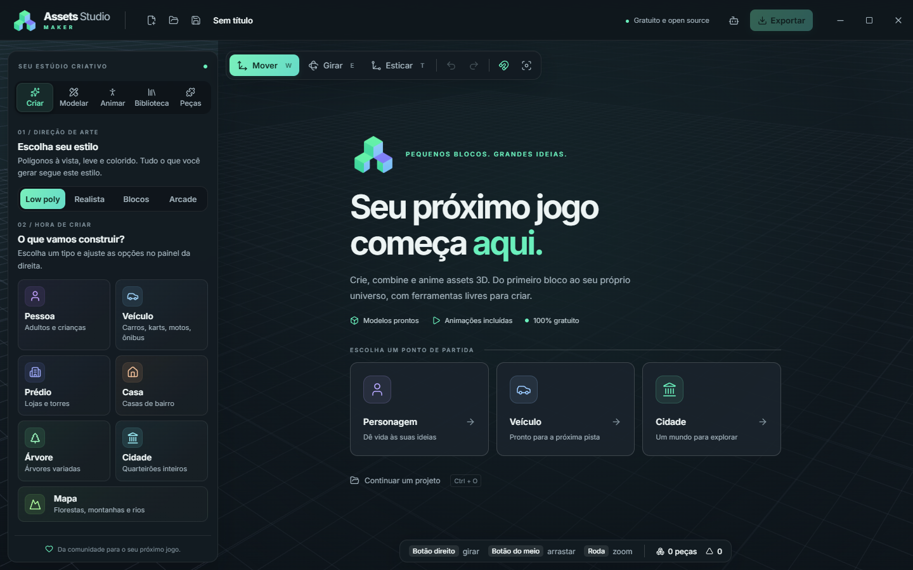

# Assets Studio Maker — identidade visual

Um estúdio aberto, acessível e criativo. O símbolo reúne três blocos isométricos em uma construção que lembra um A: pequenas peças que, juntas, viram algo maior. O nome do aplicativo permanece **Assets Studio Maker**.



[Prévia na janela mínima de 1100 × 640](docs/identity-preview-compact.png).

## Arquivos

- `public/brand/asset-studio-symbol.png`: original transparente, 1280 × 1280, para divulgação e novos formatos.
- `public/brand/asset-studio-symbol-256.png`: símbolo leve usado na interface.
- `public/brand/asset-studio-symbol-32.png`: favicon.
- `src-tauri/icons/`: ícones PNG e ICO do aplicativo e do instalador Windows; `source.png` mantém a fonte de geração.
- `src/ui/Brand.tsx`: assinatura com símbolo e nome em texto, para manter a tipografia legível em qualquer escala.

## Sistema visual

| Uso | Cor |
| --- | --- |
| Fundo e cabeçalho | `#101719` |
| Painéis | `#131B21` |
| Texto principal | `#EDF4F4` |
| Texto secundário | `#A4B4BE` |
| Ação principal / menta | `#6AEFBC` |
| Apoio / azul | `#9BCAFF` |
| Personagens / lilás | `#B6A7FF` |

Fonte: Inter Variable, incluída localmente. Cantos de 8–14 px, bordas discretas, ícones Lucide e sombras contidas. Menta identifica ações principais e estados ativos; as cores por categoria ajudam a localizar geradores. A área 3D continua sendo o centro do trabalho.

Use o símbolo sem deformação, sobre superfícies tranquilas e com respiro. O PNG possui transparência real. A assinatura completa é construída com texto na interface; evite colocar textos pequenos dentro do bitmap.

A tela inicial apresenta os caminhos de criação, animações e gratuidade. Painéis longos mantêm rolagem própria. O layout adapta controles e espaçamentos até a janela mínima de 1100 × 640. A preferência do sistema por movimento reduzido é respeitada.

## Origem e reprodução

O símbolo foi criado com a ferramenta integrada de geração de imagens do Codex (`image_gen`), sem CLI de geração nem chave de API. Os formatos menores e o ICO foram derivados pelo comando `pnpm exec tauri icon`, preservando transparência. A identidade segue a licença MIT do projeto; os créditos e as licenças dos modelos e animações permanecem em `CREDITS.md`.

Prompt final usado na geração:

```text
Use case: logo-brand
Asset type: production app logo symbol for Assets Studio Maker, a free open-source desktop 3D game asset creation studio.
Primary request: Create one exceptionally polished, simple and memorable geometric brand symbol representing modular building blocks becoming a creative world. A compact isometric assembly of three interlocking solid cubes, arranged as a subtle ascending A silhouette with a deliberate negative-space opening. Bold clear silhouette readable at 32px. Mint green upper and left faces, soft icy blue right faces, one restrained periwinkle accent. Consistent isometric angles, crisp edges, very subtly rounded corners, flat vector-like solid faces, only natural face-to-face color variation. Premium creative software brand, playful precision.
Composition: one centered isolated symbol filling about 80 percent of a square canvas, balanced optical weight.
Background: genuinely transparent.
Constraints: symbol only, no text, no letters, no wordmark, no watermark, no mockup, no border, no background tile, no shadows outside the symbol, no floating sparkles, no tiny details, no glass or chrome materials.
```
