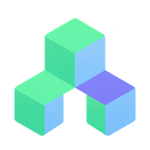
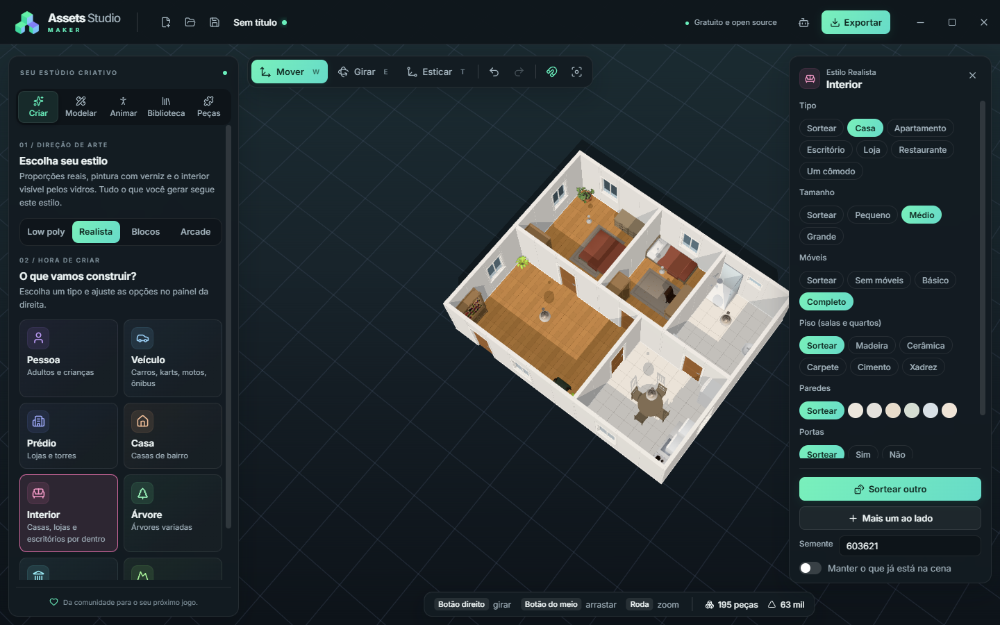

<p align="center"></p>

<h1 align="center">Assets Studio Maker</h1>

<p align="center"><strong>Pequenos blocos. Grandes ideias.</strong><br />Um estúdio gratuito e open source de assets 3D para o seu próximo jogo.</p>

<p align="center">
  <a href="LICENSE"></a>
  
  <a href="#créditos-e-agradecimentos"></a>
</p>

<p align="center"></p>

O Assets Studio Maker é um editor de assets 3D para quem está começando a criar jogos: a liberdade
de um programa de modelagem, com ferramentas que dá para entender no primeiro uso. Você encaixa
blocos prontos, sorteia modelos inteiros (pessoas, veículos, casas, interiores mobiliados, cidades,
mapas), molda formas novas, anima personagens e exporta GLB para o seu motor de jogo. Um agente de
IA também pode modelar por você, pelo protocolo MCP.

> **Estado atual: início do desenvolvimento.** Já dá para montar, modelar, animar, salvar projetos
> e exportar GLB para usar em jogos. O editor é só para Windows. Veja o [roteiro](#roteiro).

## Índice

- [Recursos](#recursos)
- [Baixar e instalar](#baixar-e-instalar)
- [Primeiros passos](#primeiros-passos)
- [Geradores](#geradores)
- [Modelar do zero](#modelar-do-zero)
- [Animar](#animar)
- [Exportar para um jogo](#exportar-para-um-jogo)
- [Agente de IA](#agente-de-ia)
- [Atalhos](#atalhos)
- [Desenvolvimento](#desenvolvimento)
- [Roteiro](#roteiro)
- [Como contribuir](#como-contribuir)
- [Licença](#licença)
- [Créditos e agradecimentos](#créditos-e-agradecimentos)

## Recursos

- Biblioteca com 955 modelos prontos em CC0: veículos, construções, móveis e interiores, ruas,
  natureza e personagens
- Mais de 1.600 peças próprias para montar, nos estilos Low poly, Realista, Blocos e Arcade: karts,
  carros, caminhões, ônibus, carretas, motos, casas, prédios, paredes, pisos, portas e janelas de
  interiores, móveis, corpo, rosto, cabelo e chapéus, rodas, ruas, mobiliário urbano e natureza
- Geradores com opções e estilo único: pessoa (homem, mulher, adulto, criança e mais), veículo
  (carros, karts, motos, caminhões, ônibus e carretas), prédio, casa, interior (casa, apartamento,
  escritório, loja, restaurante ou um cômodo, já mobiliados), árvore, cidade (com ruas irregulares,
  orgânicas ou em grade) e mapa
- 201 animações prontas para as pessoas geradas, em todos os estilos, com prévia no editor: 162 do Mesh2Motion (CC0) e 39 feitas para o editor, 12 danças (samba, forró, axé, frevo, passinho e outras) e 27 golpes de luta (socos, chutes, esquivas, defesas, golpes recebidos e capoeira)
  e exportação com esqueleto
- Veículos prontos para jogo: rodas que giram, caixa de colisão e importação direta no Godot
- Modelagem livre: comece de uma forma básica ou de qualquer peça pronta e edite faces, arestas e
  pontos, com furos, chanfros e escultura
- Encaixe por pontos verdes: passe o mouse sobre um bloco e clique em um ponto
- Mover, girar e esticar peças, com valores que se alinham a uma grade
- Materiais por peça: fosco, pintura brilhante, metal, vidro e luzes acesas
- Cor por peça, grupos, seleção múltipla, duplicar, apagar, desfazer e refazer
- Salvar e abrir projetos (`.asmproj`)
- Exportar GLB, com a cena inteira ou só a seleção (testado no Godot 4.7)
- Servidor MCP local, para um agente de IA montar modelos no editor

## Baixar e instalar

O instalador para Windows sai na página de [versões](https://github.com/Codeplay77/Assets-Studio-Maker/releases)
do projeto. Enquanto não houver uma versão publicada, rode o editor a partir do código, como em
[Desenvolvimento](#desenvolvimento).

Requisitos: Windows 10 ou 11, 64 bits. O editor usa o WebView2, que já vem no Windows 11; se ele
faltar, o instalador o instala.

## Primeiros passos

1. Na aba **Criar**, escolha um **estilo**: Low poly, Realista, Blocos ou Arcade
2. Clique em um tipo de modelo, como **Pessoa**, **Veículo** ou **Interior**, ajuste as opções à
   direita e clique em **Gerar**
3. Encaixe mais peças pela aba **Peças** ou **Biblioteca**, ou edite uma peça na aba **Modelar**
4. Anime as pessoas na aba **Animar**
5. Clique em **Exportar** (Ctrl+E) e leve o GLB para o seu jogo

## Geradores

Na aba **Criar**, escolha primeiro o **estilo**: tudo o que você gerar segue esse padrão, então
um boneco de blocos nunca aparece ao lado de um carro realista.

| Estilo | Como é |
| --- | --- |
| **Low poly** | Polígonos à vista, leve e colorido. Usa os modelos CC0 e o personagem low poly |
| **Realista** | Perto do real: pessoas do MakeHuman com pele, roupa e cabelo de verdade, que dobram nas animações; texturas fotografadas (tijolo, telha, asfalto, madeira, tecido, grama) no tamanho real; móveis, plantas e árvores escaneados do Poly Haven; prédios residenciais, antigos e comerciais com sacadas, molduras e vidro espelhado; luz de céu de verdade; e veículos com pintura com verniz, vidro fumê e rodado duplo |
| **Blocos** | Tudo feito de cubos, inclusive pessoas, carros, móveis, cidades e mapas |
| **Arcade** | Brinquedos: veículos curtos, redondos e de rodas grandes, com pintura brilhante, no visual do jogo Codeplay in Kart |

Os karts, carros, caminhões, ônibus, carretas, motos, casas e prédios do Arcade têm pintura em
três áreas (principal, secundária e detalhes), além da cor dos aros. Em **Veículo**, o tipo **Kart**
ainda deixa trocar carroceria, rodas, aerofólio, capacete, piloto e macacão. Cada área é uma peça
separada, então também dá para mudar a cor depois, no painel da direita.

Depois clique em um tipo de modelo. As opções abrem no painel da direita: na **Pessoa**, sexo,
idade, porte, altura, pele, cabelo, roupa, barba, óculos, chapéu e mochila (no Realista, a pessoa é
um corpo inteiro do MakeHuman que dobra nas animações, sem barba, óculos e mochila). O que ficar em
**Sortear** é decidido pela semente. Clique em **Gerar** e, a partir daí, cada opção alterada
atualiza o mesmo modelo sem mudar o resto. Cada mudança é um Ctrl+Z.

O modelo substitui o que está na cena. Com **Manter o que já está na cena** ligado, ele vai para o
lado do que já existe e o estilo fica preso ao da cena, para não misturar. **Mais um ao lado** soma
outro modelo do mesmo tipo.

Cada modelo sai de um número, a **semente**. A mesma semente com as mesmas opções dá sempre o mesmo
resultado. Nas abas **Peças** e **Biblioteca**, a lista mostra o estilo escolhido; use **Todos** para
ver tudo.

### Interiores

O gerador **Interior** monta o lado de dentro de uma construção: **casa**, **apartamento**,
**escritório**, **loja**, **restaurante** ou **um cômodo** só (sala, quarto, cozinha, banheiro e
outros). A planta é dividida em cômodos numa grade de 1 m: os principais (sala, salão, área de
vendas) ficam na frente, com a porta de entrada, e os outros (quartos, banheiros, cozinha
industrial, depósito) ficam atrás, cada um com porta para um cômodo da frente. As janelas vão nas
paredes de fora, e lojas e restaurantes ganham vitrine na fachada.

Cada cômodo é mobiliado como as pessoas costumam arrumar: a cama encostada na parede com um
criado-mudo de cada lado, o sofá virado para a TV, a bancada da cozinha com pia, fogão e armários
aéreos, o espelho em cima da pia, mesas com cadeiras em volta. Nada fica na frente de uma porta,
e só móveis baixos ficam embaixo das janelas. As opções escolhem o tamanho, a cor das paredes, o
piso, se há portas e teto e quantos móveis entram (nenhum, básico ou completo).

As paredes, pisos, portas e janelas também estão na aba **Peças**, em **Interiores**, para montar à
mão: cada parede tem 1 m e se encaixa na próxima pelos lados. Os móveis prontos estão na aba
**Biblioteca**, em **Interiores**.

| Estilo | Móveis |
| --- | --- |
| **Low poly** | Furniture Kit da Kenney |
| **Realista** | Modelos do Poly Haven com as texturas originais, mais camas, guarda-roupa, cozinha, banheiro e lavanderia feitos no editor com texturas fotografadas |
| **Blocos** | Os móveis da Kenney refeitos em cubos do tamanho dos que formam as pessoas |
| **Arcade** | Móveis de brinquedo próprios do editor, arredondados e com pintura brilhante |

## Modelar do zero

Na aba **Modelar**, escolha uma forma para começar. Para editar uma peça que já está na cena,
selecione e clique em **Modelar esta peça**. Com várias peças selecionadas, **Juntar e modelar**
transforma todas em uma forma só.

Clique em uma face, aresta ou ponto e arraste as setas. Com faces selecionadas, a seta verde aponta
para fora delas.

| Ferramenta | O que faz |
| --- | --- |
| **Puxar** | Puxa as faces para fora e cria paredes novas. Com valor negativo, afunda |
| **Moldura** | Cria uma face menor dentro de cada face |
| **Dividir** | Corta as faces em faces menores |
| **Arredondar** | Transforma cantos em curvas na forma inteira |
| **Suavizar** | Alisa a superfície |
| **Espelhar** | Refaz um lado como reflexo do outro: modele metade e espelhe |
| **Juntar** | Une os pontos selecionados em um só |
| **Criar face** | Fecha um buraco passando pelos pontos selecionados |
| **Arraste suave** | Faz os pontos próximos acompanharem o movimento, bom para formas orgânicas |
| **Chanfrar** | Corta as arestas selecionadas, em reta ou em curva. Sem seleção, corta todas as quinas vivas |
| **Furar** | Abre um furo redondo ou quadrado no meio de cada face selecionada |

Fora das setas, arraste para selecionar com um retângulo. Só entra o que está visível.

Na opção **Esculpir**, passe o pincel sobre a forma para levantar, afundar, alisar, achatar ou
agarrar a superfície. Segure Ctrl para inverter o efeito e Shift para alisar. Formas com poucos
pontos ganham mais detalhe com o botão **Aumentar detalhe**.

Para combinar peças inteiras, deixe uma encostada na outra, selecione as duas e use **Furar**,
**Unir** ou **Comum** no painel da direita. A primeira peça clicada é a que recebe o furo.

Cada face pode ter cor e acabamento próprios. As formas ficam em **Minhas formas**, de onde você
coloca outras cópias na cena. Alterar uma forma muda todas as peças que a usam. Para criar uma
variação, faça uma cópia independente nesse mesmo painel.

## Animar

Na aba **Animar**, escolha o personagem e clique numa animação para ver o personagem se mexer. São
201 animações prontas, em categorias como andar e correr, luta, espada, armas, magia, gestos,
dança, tarefas, nadar e escalar. Marque as que o personagem deve levar no arquivo: a escolha fica
salva no projeto e cada mudança pode ser desfeita com Ctrl+Z. Nas animações que andam para algum
lugar, **Sem sair do lugar** mantém o personagem parado na prévia.

Funciona com qualquer pessoa do gerador, nos quatro estilos. O editor reconhece os blocos do corpo
(quadril, tronco, pescoço, cabeça, braços, antebraços, mãos, coxas, canelas e sapatos), monta o
esqueleto pelos encaixes, e o resto (rosto, cabelo, chapéu, saia, mochila) acompanha o osso onde
está encaixado. As animações se ajustam à altura e às proporções de cada personagem. As pessoas do
Realista também mexem os dedos: fecham a mão para socar, seguram a pistola e gesticulam.

Ao exportar, cada personagem com animações vira uma malha com esqueleto. Os ossos têm os nomes do
manequim da Unreal (`pelvis`, `spine_03`, `upperarm_l`...), que o Godot reconhece no
redirecionamento de animações humanoides. As animações saem com nomes simples em português, como
`andar`, `parado` e `pistola_atirar`. Com **Pronto para o Godot**, as que se repetem, como andar e
correr, já chegam em ciclo.

## Exportar para um jogo

Clique em **Exportar** (ou Ctrl+E) e escolha:

- **Só o que está selecionado**, para exportar um modelo e deixar o resto da cena de fora
- **Juntar em uma malha só**, mais leve no jogo porque vira uma peça única
- **Centralizar na origem**, que coloca a base do modelo no ponto zero

As cores vão nos vértices do modelo. As texturas do estilo Realista vão dentro do próprio `.glb`,
em JPEG, com cor, relevo e o mapa de oclusão, rugosidade e metal que o glTF usa.

### Veículos prontos para jogo

Quando há veículos na cena, o diálogo mostra mais duas opções.

**Veículos prontos para jogo** dá a cada veículo um nó próprio, no chão, entre os eixos e de frente
para +Z. Cada roda vira um nó no centro do eixo, para o jogo girar e esterçar:
`roda_dianteira_esquerda`, `roda_traseira_2_direita` e assim por diante. Os dois pneus de um rodado
duplo ficam no mesmo nó. A carreta sai como outro veículo, com a origem embaixo do pino-rei e rodas
chamadas `roda_carreta_1_esquerda`. Um veículo exportado sozinho fica no ponto zero, mesmo que esteja
girado na cena.

Cada nó leva dados extras (`extras` no glTF), que o jogo pode ler:

| Nó | Dados |
| --- | --- |
| Veículo | `rodas`, `colisao` (centro e tamanho da caixa), `engate` no cavalo e `pino_rei` na carreta |
| Roda | `raio`, `largura`, `direcao` (esterça), `tracao` e `dupla` |

**Pronto para o Godot** faz o Godot 4 montar tudo ao importar: o veículo vira um `VehicleBody3D`,
as rodas viram `VehicleWheel3D` e a carroceria ganha uma caixa de colisão (`CollisionShape3D`). Foi
testado no Godot 4.7. O Godot não lê o raio das rodas do arquivo, então coloque este script em
qualquer nó acima do modelo importado:

```gdscript
extends Node3D

func _ready() -> void:
	for roda in find_children("*", "VehicleWheel3D", true, false):
		var dados: Dictionary = roda.get_meta("extras", {})
		roda.wheel_radius = dados.get("raio", roda.wheel_radius)
		roda.use_as_steering = dados.get("direcao", false)
		roda.use_as_traction = dados.get("tracao", false)
```

Depois ajuste no Godot a massa (`mass`), a suspensão das rodas e a força do motor (`engine_force`)
para o seu jogo. Para puxar uma carreta, ligue os dois veículos com uma junta no ponto `engate`.
Exporte um veículo por arquivo: com vários no mesmo arquivo, o Godot põe um número no fim dos nomes
repetidos.

As rodas das motos ainda fazem parte do modelo e não giram sozinhas.

## Agente de IA

Um agente de IA pode montar modelos para você neste editor, usando o protocolo MCP. Tudo o que ele
faz aparece na hora, e cada ação pode ser desfeita com Ctrl+Z.

1. Clique no ícone de robô, no canto superior direito, e ligue **Permitir agentes neste computador**
2. Copie o comando (Claude Code) ou o JSON (outros agentes) e adicione ao seu agente
3. Peça algo como "monte um personagem de moletom vermelho" com o editor aberto

O agente não fica preso aos blocos prontos. Ele cria formas novas a partir de formas básicas,
perfis girados, seções, tubos, silhuetas ou polígonos livres, e edita tudo com as mesmas operações
da aba **Modelar**. Também encaixa peças, usa os geradores e recebe imagens do modelo para conferir
o resultado.

O servidor vem desligado e só funciona com o editor aberto. Ele aceita conexões apenas deste
computador e exige uma chave de acesso, que você troca no mesmo painel. O agente não abre nem salva
projetos. As exportações dele vão para `Documentos\Assets Studio Maker\Exportados` e nunca
substituem um arquivo.

| Ferramenta | O que faz |
| --- | --- |
| `get_scene`, `get_part` | Lê a cena, com medidas e encaixes |
| `search_blocks`, `get_block` | Procura blocos e mostra tamanho e encaixes |
| `create_shape` | Cria uma forma nova, com geometria livre |
| `edit_shape` | Puxa faces, fura, chanfra, combina formas, esculpe, arredonda, espelha e pinta |
| `generate` | Gera pessoas, veículos, prédios, casas, interiores, árvores, cidades e mapas, com estilo e opções |
| `get_shape`, `list_shapes` | Lê as formas do projeto, inclusive pontos e faces |
| `update_shape`, `duplicate_shape`, `delete_shape` | Altera, copia e apaga formas |
| `convert_to_shape` | Transforma peças prontas em uma forma editável |
| `add_parts`, `attach_part` | Coloca blocos livres ou encaixados em outra peça |
| `update_parts`, `move_parts`, `duplicate_parts`, `remove_parts` | Altera as peças |
| `group_parts`, `clear_scene` | Agrupa as peças e limpa a cena |
| `capture_view` | Devolve imagens do modelo, de vários ângulos |
| `frame_view` | Enquadra o modelo na sua tela |
| `undo`, `redo` | Desfaz e refaz |
| `list_animations` | Lista as animações prontas e os personagens da cena |
| `set_animations` | Escolhe as animações que um personagem leva no arquivo |
| `preview_animation` | Mostra um personagem num momento de uma animação, para conferir com `capture_view` |
| `export_glb` | Exporta um arquivo GLB, com veículos prontos para jogo e personagens animados |

## Atalhos

| Tecla | Ação |
| --- | --- |
| Clique | Coloca o bloco escolhido ou seleciona o modelo inteiro |
| Clique duplo | Seleciona só aquela peça do modelo |
| Shift + clique | Soma à seleção |
| Ctrl+A | Seleciona tudo |
| Ctrl+G / Ctrl+Shift+G | Agrupa / desagrupa |
| Ctrl+N / Ctrl+O / Ctrl+S | Novo / abrir / salvar |
| Ctrl+Shift+S | Salvar como |
| Ctrl+E | Exportar GLB |
| R | Gira o bloco antes de colocar |
| Esc | Termina de colocar ou limpa a seleção |
| W / E / T | Mover / girar / esticar |
| F | Enquadra a peça selecionada ou o modelo inteiro |
| Ctrl+Z / Ctrl+Y | Desfaz / refaz |
| Ctrl+D | Duplica |
| Delete | Apaga |
| Tab | Entra e sai da modelagem da peça selecionada |
| 1 / 2 / 3 | Modelagem: faces / arestas / pontos |
| 4 | Modelagem: esculpir |
| P / I | Modelagem: puxar / moldura |
| B | Modelagem: chanfrar |
| [ / ] | Modelagem: diminuir / aumentar o pincel |
| Botão direito | Gira a câmera |
| Botão do meio | Arrasta a câmera |
| Roda do mouse | Aproxima ou afasta |

## Desenvolvimento

### Rodar a partir do código

Você precisa do [Rust](https://rustup.rs), do [Node.js](https://nodejs.org) 24, do
[pnpm](https://pnpm.io) e das ferramentas de C++ do Visual Studio.

```powershell
git clone https://github.com/Codeplay77/Assets-Studio-Maker.git
cd Assets-Studio-Maker
pnpm install
pnpm tauri dev
```

Para conferir se tudo compila sem abrir o editor:

```powershell
npx tsc --noEmit -p .
cargo check --manifest-path src-tauri/Cargo.toml
```

Para lançar uma versão, atualize o número em `src-tauri/tauri.conf.json` e envie uma tag com ele:

```powershell
git tag v0.2.0
git push origin v0.2.0
```

O GitHub gera o instalador do Windows e o deixa num rascunho de versão, que só fica público quando
você o publica.

### Como o projeto é organizado

A interface e o viewport 3D são feitos em TypeScript com React e Three.js. O Rust, com Tauri,
guarda o projeto e aplica todas as alterações.

| Pasta | Conteúdo |
| --- | --- |
| `src/blocks/definitions/` | Onde cada bloco é definido |
| `src/blocks/blocks.json` | Catálogo gerado, lido pela interface e pelo Rust |
| `src/blocks/definitions/family/` | Família Arcade: karts, veículos, casas e prédios, com pintura em camadas |
| `src/blocks/definitions/interior.ts` | Paredes, pisos, portas e janelas dos quatro estilos, e os móveis Arcade |
| `src/blocks/definitions/styleize.ts` | Converte um modelo de um estilo para os outros |
| `src/generators/` | Geradores aleatórios; os interiores ficam em `interior.ts` |
| `src/modeling/` | Malha editável, formas básicas e operações de modelagem |
| `src/animation/` | Esqueleto dos personagens, leitura das animações e prévia |
| `src/export/` | Exportação GLB, veículos prontos para jogo e personagens com esqueleto |
| `src/viewport/` | Cena 3D e cálculo de encaixe |
| `src/ui/` | Painéis e atalhos |
| `src/mcp/` | Ferramentas do agente de IA |
| `src-tauri/src/document.rs` | O projeto, os comandos e o histórico de desfazer |
| `src-tauri/src/mcp.rs` | Servidor MCP: conexão, chave de acesso e protocolo |
| `public/models/` | Pacotes de modelos: `pack.bin` (biblioteca), `interior.bin` (móveis), `vehicles.bin` (veículos), `realista.bin` (modelos do Poly Haven) e `pessoas.bin` (pessoas do Realista) |
| `public/textures/` | As texturas do Realista, uma pasta por material com `color`, `normal` e `arm` |
| `public/environments/` | O céu que ilumina as cenas Realistas |
| `public/animations/` | Pacote de animações |
| `scripts/` | Importadores que geram os pacotes de modelos e de animações |
| `tools/blender/` | Scripts do Blender que modelam os veículos, preparam os modelos do Poly Haven e montam as pessoas do Realista |

Toda forma criada é uma malha de polígonos guardada no projeto, com o id `shape.N`, que funciona
como qualquer bloco. A interface e o agente usam as mesmas operações, em
`src/modeling/operations.ts`, e o Rust valida o resultado antes de aceitar.

Toda alteração é um comando aplicado em `document.rs`. A interface só desenha o estado que o
Rust publica, e o agente de IA usa esses mesmos comandos. Assim, o que ele faz aparece na hora e
pode ser desfeito. As ferramentas do agente rodam na interface, que já tem o catálogo, os
geradores e o viewport.

### Criar um bloco

Adicione o bloco em `src/blocks/definitions/` e rode `pnpm catalog`. O primeiro item de `sockets`
é o ponto que o bloco usa para se encaixar nos outros. Partes sem `color` seguem a cor escolhida
pela pessoa, e partes com `color` mantêm a própria cor, como vidros e pneus. Com o `tauri dev`
aberto, reinicie depois de `pnpm catalog`, porque o Rust embute o catálogo ao compilar.

### Atualizar a biblioteca de modelos

Baixe os pacotes da Kenney listados em [Créditos](#modelos-3d), descompacte cada um em
`<pasta>/<pacote>/x/` e rode:

```powershell
node scripts/import-models.ts <pasta>
pnpm catalog
```

Só adicione modelos CC0. A lista de pacotes, a escala e a categoria ficam no início de
`scripts/import-models.ts`. Registre todo pacote novo nos [créditos](#créditos-e-agradecimentos)
deste README e no [CREDITS.md](CREDITS.md).

### Atualizar os móveis

Os móveis da Kenney (Low poly e Blocos) têm um pacote próprio, `public/models/interior.bin`:

```powershell
node scripts/download-interior.ts <pasta>
node scripts/import-interior.ts <pasta>
pnpm catalog
```

Para conferir os modelos antes de usar, acrescente `--debug <outra pasta>` ao segundo comando:
cada um sai também como OBJ com as cores, para abrir no Blender. Os nomes em português e a forma de
prender cada peça (no chão, na parede ou no teto) ficam em `scripts/interior-names.ts`. Um modelo
sem nome ali aparece com o nome do arquivo e um aviso.

### Atualizar o Realista

As texturas, os modelos do Poly Haven e o céu do Realista vêm de três comandos. O primeiro baixa
tudo numa pasta (cerca de 1,6 GB, porque as árvores escaneadas são grandes; o Blender chega a usar 16 GB de memória nelas); o segundo reduz cada
modelo no Blender a um tamanho de jogo sem perder as texturas, separa as variações que vêm lado a
lado num arquivo e faz uma cópia leve das plantas e pedras para mapas e cidades; o terceiro gera
`public/models/realista.bin`, `public/textures/` e o catálogo:

```powershell
node scripts/download-realistic.ts <pasta>
blender -b --factory-startup --python tools/blender/prepare_polyhaven.py -- <pasta> <pasta>/preparados
node scripts/import-realistic.ts <pasta> <pasta>/preparados
pnpm catalog
```

As texturas que se repetem (paredes, pisos, ruas, terreno) estão em `src/blocks/surfaces.ts`, com o
tamanho real que cada foto cobre. Os modelos, seus nomes em português e onde cada um se prende estão
em `scripts/realistic-names.ts`. O terceiro comando também escreve, na pasta dos preparados, a lista
de autores para os créditos.

### Atualizar as pessoas do Realista

As pessoas do Realista são montadas no Blender 5.1 com o [MPFB](https://extensions.blender.org/add-ons/mpfb/)
e o pacote [makehuman system assets](https://static.makehumancommunity.org/assets/assetpacks/makehuman_system_assets.html).
Para não mexer no Blender do dia a dia, instale o MPFB numa pasta de usuário separada e descompacte
o pacote dentro da pasta de dados dele:

```bash
export BLENDER_USER_RESOURCES=<pasta>/blender_user
blender --factory-startup --command extension install-file -r user_default -e <mpfb.zip>
# descompacte makehuman_system_assets_cc0.zip em <pasta>/blender_user/extensions/.user/user_default/mpfb/data
blender --factory-startup -b --python tools/blender/make_people.py -- <pasta>/pessoas
node scripts/import-people.ts <pasta>/pessoas
pnpm catalog
```

Os corpos, as roupas de cada um e os cabelos estão no início de `tools/blender/make_people.py`. Para
refazer só alguns corpos, passe os nomes depois da pasta (`-- <pasta>/pessoas homem,mulher`). O
gerador de Pessoa escolhe entre eles em `src/generators/realPerson.ts`.

### Atualizar os veículos

Todos os veículos do editor (carros, SUVs, picapes, vans, caminhões, ônibus, carretas, motos e
karts, com rodas, piloto, capacetes e aerofólios) são modelados por script no Blender 5.1. O mesmo
desenho gera os quatro estilos: Arcade e Realista usam o modelo completo, Low poly usa uma versão
com poucas faces planas e Blocos usa essa versão convertida em voxels. Para gerar tudo de novo:

```bash
blender -b --factory-startup --python tools/blender/build_vehicles.py -- --export
pnpm catalog
```

O primeiro comando grava `public/models/vehicles.bin` e
`src/blocks/definitions/family/baked.generated.ts`. Para ver um modelo sem exportar, use
`-- sedan --preview saida.png` no lugar de `-- --export`; acrescente `--lod lp` ou `--lod vx` para
ver as versões Low poly e Blocos.

### Atualizar as animações

As animações ficam em `public/animations/human.bin`, com os nomes em português em
`src/animation/library.generated.ts`. Elas vêm dos arquivos do Mesh2Motion e das danças e golpes do
editor, que o Blender monta sobre o mesmo esqueleto. Para gerar de novo:

```powershell
blender --factory-startup -b --python tools/blender/make_dances.py -- <pasta do Mesh2Motion>/human-base-animations.glb <pasta>/dancas.glb
blender --factory-startup -b --python tools/blender/make_combat.py -- <pasta do Mesh2Motion>/human-base-animations.glb <pasta>/combate.glb
node scripts/import-animations.ts <pasta com human-base-animations.glb e human-addon-animations.glb> <pasta>/dancas.glb <pasta>/combate.glb
```

Cada dança ou golpe é uma lista de poses-chave, no fim do seu script: onde fica cada pé, para onde
vão as mãos em relação ao peito, para onde apontam cotovelos e joelhos, quanto giram quadril,
tronco, ombros e cabeça e quanto cada mão está fechada. Pernas e braços seguem essas posições por
IK (`tools/blender/poser.py`, comum aos dois scripts). Nas danças, um pé que muda de lugar é
levantado no meio do caminho, para não deslizar. Nos golpes, para não parecerem robóticos, cada
valor segue uma curva suave entre as poses, o golpe acelera até o impacto, o quadril sai antes, a
cabeça chega depois e a respiração nunca deixa o corpo parado. Todos os golpes começam e terminam
na mesma guarda, para um jogo poder emendar um no outro. Com `--previa <pasta>`, o
`make_combat.py` também fotografa o manequim em alguns quadros de cada golpe, de frente e de lado. Um clipe novo precisa de um nome em português na tabela `NAMES` do
importador. Ações que acontecem uma vez (ataques, abrir baú, morrer) ficam na lista `ONCE`, para não
repetirem no jogo.

## Roteiro

1. **Montagem por blocos e geradores:** feitos
2. **Salvar e exportar:** feitos, com exportação GLB testada no Godot 4.7
3. **Agente de IA:** feito, com servidor MCP local e captura do viewport
4. **Modelagem livre:** feita, com faces, arestas, pontos, furos, chanfros e escultura, pela
   interface e pelo agente
5. **Animação:** feita, com esqueleto criado a partir dos encaixes, 201 animações prontas, prévia
   e exportação com esqueleto
6. **Interiores:** feitos, com móveis nos quatro estilos e o gerador Interior
7. **Linha do tempo:** ajuste simples de poses e novas animações próprias do editor
8. **Mais conteúdo:** estilos Neon e Desenho, animais e itens

## Como contribuir

Contribuições são bem-vindas, de correções de texto a geradores novos. O passo a passo está no
[guia de contribuição](CONTRIBUTING.md). Em resumo:

- Para relatar um erro ou sugerir algo, abra uma [issue](https://github.com/Codeplay77/Assets-Studio-Maker/issues)
- Para mudar o código, faça um fork, crie um branch e abra um pull request com o projeto
  compilando e a mudança conferida no editor
- O editor é em português do Brasil: textos da interface, nomes de blocos e mensagens
- Só entram modelos, animações e texturas em CC0, registrados nos créditos
- Todo gerador e bloco novo precisa existir nos quatro estilos

Quem participa do projeto segue o [código de conduta](CODE_OF_CONDUCT.md). Para relatar uma falha
de segurança, veja a [política de segurança](SECURITY.md).

## Licença

O código é distribuído sob a [licença MIT](LICENSE). Os modelos e as animações de terceiros
incluídos no editor são CC0 (domínio público), e as bibliotecas usadas têm licenças permissivas;
tudo está listado logo abaixo. Logo, paleta e orientações de uso da marca estão no
[guia de identidade visual](BRAND.md).

## Créditos e agradecimentos

O Assets Studio Maker só existe porque muita gente publica o próprio trabalho de graça. O domínio
público (CC0) não exige atribuição, mas o crédito é merecido. A lista com os detalhes de cada
conversão também está no [CREDITS.md](CREDITS.md).

### Modelos 3D

**[Kenney](https://kenney.nl)**: veículos, construções, ruas, natureza, personagens e móveis em
Low poly, e os móveis convertidos em cubos do estilo Blocos. Todos baixados das publicações do
próprio Kenney no OpenGameArt, cada pacote com um `License.txt` CC0. As texturas viraram cores por
vértice e as escalas foram levadas a medidas reais.

| Pacote | Versão | Origem |
| --- | --- | --- |
| Car Kit | 3.1 | [OpenGameArt](https://opengameart.org/content/car-kit) |
| City Kit (Commercial) | 2.1 | [OpenGameArt](https://opengameart.org/content/city-kit-commercial) |
| City Kit (Suburban) | 2.0 | [OpenGameArt](https://opengameart.org/content/city-kit-suburban) |
| City Kit (Roads) | 2.2 | [OpenGameArt](https://opengameart.org/content/city-kit-roads) |
| Racing Kit (só o piso de grama) | 1.2 | [OpenGameArt](https://opengameart.org/content/racing-kit) |
| Nature Kit | 2.1 | [OpenGameArt](https://opengameart.org/content/nature-kit) |
| Blocky Characters | 2.0 | [OpenGameArt](https://opengameart.org/content/blocky-characters) |
| Furniture Kit | 1.0 | [OpenGameArt](https://opengameart.org/content/furniture-kit) |

**[Poly Haven](https://polyhaven.com)**: tudo o que o estilo Realista traz de fora, todo CC0:
145 modelos escaneados com as texturas originais (móveis, plantas, árvores, pedras e objetos de
rua), 39 texturas de materiais e o céu que ilumina as cenas. Os modelos são de Rico Cilliers (32 modelos), James Ray Cock (23), Kirill Sannikov (19), Rob Tuytel (17), Ulan Cabanilla (12), Kuutti Siitonen (9), Jenelle van Heerden (5), Yann Kervran (5), Amal Kumar (3), Ethan Place (3), Fran Calvente (3), Amin (2), Aron Łyczek (2), Benny Weimer (2), Dario Barresi (2), Gabriel Radić (2), Josh Dean (2), PierreB3D (2), Adam Nekola, Alexander Otterbeck, Arrangemonk, Caspian Fortune, Dairon Sanchez, Fernando Quinn, Gonçalo Felício, Greg Zaal, GurJas Studios, Jake Mobley, Joe Seabuhr, Jorge Camacho, Kless Gyzen, Luca B, Maximilian Schuster, Monsta3D, ParzivalCG, Patrik Pangerl, PeterM, Plat251, Rahul Chaudhary, Raunox, SV Garip, Sean Buckley, Serhii Khromov, Slinc, Thomas Paul Mouilleron e Vibrant Nordic.

<details>
<summary>Os 145 modelos e as 39 texturas do Poly Haven, com seus autores</summary>

| Modelo | Autor | Página |
| --- | --- | --- |
| Alarm Clock 01 | Yann Kervran, James Ray Cock | [alarm_clock_01](https://polyhaven.com/a/alarm_clock_01) |
| Anthurium Botany 01 | Rob Tuytel, Rico Cilliers | [anthurium_botany_01](https://polyhaven.com/a/anthurium_botany_01) |
| Arm Chair 01 | Kirill Sannikov | [ArmChair_01](https://polyhaven.com/a/ArmChair_01) |
| Bar Chair Round 01 | Dairon Sanchez | [bar_chair_round_01](https://polyhaven.com/a/bar_chair_round_01) |
| Boombox | Thomas Paul Mouilleron | [boombox](https://polyhaven.com/a/boombox) |
| Calathea Orbifolia 01 | Rob Tuytel, Rico Cilliers | [calathea_orbifolia_01](https://polyhaven.com/a/calathea_orbifolia_01) |
| Cardboard Box 01 | Rahul Chaudhary | [cardboard_box_01](https://polyhaven.com/a/cardboard_box_01) |
| Cash Register 01 | Joe Seabuhr | [CashRegister_01](https://polyhaven.com/a/CashRegister_01) |
| Ceiling Fan | Ulan Cabanilla | [ceiling_fan](https://polyhaven.com/a/ceiling_fan) |
| Ceramic Vase 01 | James Ray Cock | [ceramic_vase_01](https://polyhaven.com/a/ceramic_vase_01) |
| Ceramic Vase 02 | James Ray Cock | [ceramic_vase_02](https://polyhaven.com/a/ceramic_vase_02) |
| Ceramic Vase 03 | James Ray Cock | [ceramic_vase_03](https://polyhaven.com/a/ceramic_vase_03) |
| Chandelier 01 | Kirill Sannikov | [Chandelier_01](https://polyhaven.com/a/Chandelier_01) |
| Chinese Screen Panels | Kirill Sannikov | [chinese_screen_panels](https://polyhaven.com/a/chinese_screen_panels) |
| Classic Laptop | Arrangemonk | [classic_laptop](https://polyhaven.com/a/classic_laptop) |
| Classic Console 01 | Kirill Sannikov | [ClassicConsole_01](https://polyhaven.com/a/ClassicConsole_01) |
| Classic Nightstand 01 | Kirill Sannikov | [ClassicNightstand_01](https://polyhaven.com/a/ClassicNightstand_01) |
| Coffee Table Round 01 | Ulan Cabanilla | [coffee_table_round_01](https://polyhaven.com/a/coffee_table_round_01) |
| Coffee Table 01 | Fernando Quinn | [CoffeeTable_01](https://polyhaven.com/a/CoffeeTable_01) |
| Desk Lamp Arm 01 | Yann Kervran, Kuutti Siitonen | [desk_lamp_arm_01](https://polyhaven.com/a/desk_lamp_arm_01) |
| Dining Chair 02 | James Ray Cock | [dining_chair_02](https://polyhaven.com/a/dining_chair_02) |
| Dining Table | Aron Łyczek | [dining_table](https://polyhaven.com/a/dining_table) |
| Drawer Cabinet | Ulan Cabanilla | [drawer_cabinet](https://polyhaven.com/a/drawer_cabinet) |
| Electric Stove | Kuutti Siitonen | [electric_stove](https://polyhaven.com/a/electric_stove) |
| Fancy Picture Frame 01 | Rob Tuytel, Rico Cilliers | [fancy_picture_frame_01](https://polyhaven.com/a/fancy_picture_frame_01) |
| Fire Alarm | Slinc | [fire_alarm](https://polyhaven.com/a/fire_alarm) |
| Folding Wooden Stool | Ulan Cabanilla | [folding_wooden_stool](https://polyhaven.com/a/folding_wooden_stool) |
| Gaming Console | Sean Buckley | [gaming_console](https://polyhaven.com/a/gaming_console) |
| Gothic Bed 01 | Kirill Sannikov | [GothicBed_01](https://polyhaven.com/a/GothicBed_01) |
| Gothic Cabinet 01 | Kirill Sannikov | [GothicCabinet_01](https://polyhaven.com/a/GothicCabinet_01) |
| Gothic Commode 01 | Kirill Sannikov | [GothicCommode_01](https://polyhaven.com/a/GothicCommode_01) |
| Green Chair 01 | Kirill Sannikov | [GreenChair_01](https://polyhaven.com/a/GreenChair_01) |
| Hanging Industrial Lamp | Kuutti Siitonen | [hanging_industrial_lamp](https://polyhaven.com/a/hanging_industrial_lamp) |
| Hanging Picture Frame 01 | James Ray Cock | [hanging_picture_frame_01](https://polyhaven.com/a/hanging_picture_frame_01) |
| Industrial Coffee Table | Ulan Cabanilla | [industrial_coffee_table](https://polyhaven.com/a/industrial_coffee_table) |
| Industrial Wall Lamp | Kuutti Siitonen | [industrial_wall_lamp](https://polyhaven.com/a/industrial_wall_lamp) |
| Mantel Clock 01 | Yann Kervran, Rico Cilliers | [mantel_clock_01](https://polyhaven.com/a/mantel_clock_01) |
| Metal Office Desk | Ulan Cabanilla | [metal_office_desk](https://polyhaven.com/a/metal_office_desk) |
| Metal Stool 01 | Ulan Cabanilla | [metal_stool_01](https://polyhaven.com/a/metal_stool_01) |
| Metal Trash Can | GurJas Studios | [metal_trash_can](https://polyhaven.com/a/metal_trash_can) |
| Mid Century Lounge Chair | Kuutti Siitonen | [mid_century_lounge_chair](https://polyhaven.com/a/mid_century_lounge_chair) |
| Modern Arm Chair 01 | Vibrant Nordic | [modern_arm_chair_01](https://polyhaven.com/a/modern_arm_chair_01) |
| Modern Ceiling Lamp 01 | James Ray Cock | [modern_ceiling_lamp_01](https://polyhaven.com/a/modern_ceiling_lamp_01) |
| Modern Coffee Table 01 | Amin | [modern_coffee_table_01](https://polyhaven.com/a/modern_coffee_table_01) |
| Modern Coffee Table 02 | Amin | [modern_coffee_table_02](https://polyhaven.com/a/modern_coffee_table_02) |
| Modern Wooden Cabinet | Patrik Pangerl | [modern_wooden_cabinet](https://polyhaven.com/a/modern_wooden_cabinet) |
| Old Bed Frame | Luca B | [old_bed_frame](https://polyhaven.com/a/old_bed_frame) |
| Ornate Mirror 01 | James Ray Cock | [ornate_mirror_01](https://polyhaven.com/a/ornate_mirror_01) |
| Ottoman 01 | Caspian Fortune | [Ottoman_01](https://polyhaven.com/a/Ottoman_01) |
| Pachira Aquatica 01 | Rob Tuytel, Rico Cilliers | [pachira_aquatica_01](https://polyhaven.com/a/pachira_aquatica_01) |
| Painted Wooden Cabinet | Kirill Sannikov | [painted_wooden_cabinet](https://polyhaven.com/a/painted_wooden_cabinet) |
| Painted Wooden Cabinet 02 | Kirill Sannikov | [painted_wooden_cabinet_02](https://polyhaven.com/a/painted_wooden_cabinet_02) |
| Painted Wooden Chair 02 | Kirill Sannikov | [painted_wooden_chair_02](https://polyhaven.com/a/painted_wooden_chair_02) |
| Painted Wooden Nightstand | Kirill Sannikov | [painted_wooden_nightstand](https://polyhaven.com/a/painted_wooden_nightstand) |
| Painted Wooden Shelves | Kirill Sannikov | [painted_wooden_shelves](https://polyhaven.com/a/painted_wooden_shelves) |
| Painted Wooden Sofa | Kirill Sannikov | [painted_wooden_sofa](https://polyhaven.com/a/painted_wooden_sofa) |
| Painted Wooden Table | Kirill Sannikov | [painted_wooden_table](https://polyhaven.com/a/painted_wooden_table) |
| Planter Pot Clay | Amal Kumar | [planter_pot_clay](https://polyhaven.com/a/planter_pot_clay) |
| Plastic Crate 01 | PierreB3D | [plastic_crate_01](https://polyhaven.com/a/plastic_crate_01) |
| Plastic Monobloc Chair 01 | Kuutti Siitonen | [plastic_monobloc_chair_01](https://polyhaven.com/a/plastic_monobloc_chair_01) |
| Potted Plant 01 | Rico Cilliers | [potted_plant_01](https://polyhaven.com/a/potted_plant_01) |
| Potted Plant 02 | Rico Cilliers | [potted_plant_02](https://polyhaven.com/a/potted_plant_02) |
| Potted Plant 04 | James Ray Cock | [potted_plant_04](https://polyhaven.com/a/potted_plant_04) |
| Projector Screen | PeterM | [projector_screen](https://polyhaven.com/a/projector_screen) |
| Rockingchair 01 | Jorge Camacho | [Rockingchair_01](https://polyhaven.com/a/Rockingchair_01) |
| Round Wooden Table 01 | Ulan Cabanilla | [round_wooden_table_01](https://polyhaven.com/a/round_wooden_table_01) |
| Round Wooden Table 02 | Ulan Cabanilla | [round_wooden_table_02](https://polyhaven.com/a/round_wooden_table_02) |
| Rubber Duck Toy | Plat251 | [rubber_duck_toy](https://polyhaven.com/a/rubber_duck_toy) |
| School Chair 01 | Ethan Place | [SchoolChair_01](https://polyhaven.com/a/SchoolChair_01) |
| School Desk 01 | Ethan Place | [SchoolDesk_01](https://polyhaven.com/a/SchoolDesk_01) |
| Shelf 01 | Gabriel Radić | [Shelf_01](https://polyhaven.com/a/Shelf_01) |
| Side Table 01 | James Ray Cock | [side_table_01](https://polyhaven.com/a/side_table_01) |
| Side Table Tall 01 | James Ray Cock | [side_table_tall_01](https://polyhaven.com/a/side_table_tall_01) |
| Small Wooden Table 01 | Ulan Cabanilla | [small_wooden_table_01](https://polyhaven.com/a/small_wooden_table_01) |
| Sofa 01 | Kirill Sannikov | [Sofa_01](https://polyhaven.com/a/Sofa_01) |
| Sofa 02 | Kirill Sannikov | [sofa_02](https://polyhaven.com/a/sofa_02) |
| Sofa 03 | Fran Calvente | [sofa_03](https://polyhaven.com/a/sofa_03) |
| Standing Chalkboard 01 | ParzivalCG | [standing_chalkboard_01](https://polyhaven.com/a/standing_chalkboard_01) |
| Standing Picture Frame 01 | James Ray Cock | [standing_picture_frame_01](https://polyhaven.com/a/standing_picture_frame_01) |
| Steel Frame Shelves 01 | James Ray Cock | [steel_frame_shelves_01](https://polyhaven.com/a/steel_frame_shelves_01) |
| Television 01 | Gabriel Radić | [Television_01](https://polyhaven.com/a/Television_01) |
| Television 02 | Benny Weimer | [television_02](https://polyhaven.com/a/television_02) |
| Throw Pillows 01 | Serhii Khromov | [throw_pillows_01](https://polyhaven.com/a/throw_pillows_01) |
| Vintage Cabinet 01 | Rico Cilliers | [vintage_cabinet_01](https://polyhaven.com/a/vintage_cabinet_01) |
| Vintage Day Bed | Aron Łyczek | [vintage_day_bed](https://polyhaven.com/a/vintage_day_bed) |
| Vintage Electric Kettle | SV Garip | [vintage_electric_kettle](https://polyhaven.com/a/vintage_electric_kettle) |
| Vintage Grandfather Clock 01 | Yann Kervran, James Ray Cock | [vintage_grandfather_clock_01](https://polyhaven.com/a/vintage_grandfather_clock_01) |
| Vintage Microwave | Adam Nekola | [vintage_microwave](https://polyhaven.com/a/vintage_microwave) |
| Vintage Suitcase | Maximilian Schuster | [vintage_suitcase](https://polyhaven.com/a/vintage_suitcase) |
| Vintage Wooden Drawer 01 | James Ray Cock | [vintage_wooden_drawer_01](https://polyhaven.com/a/vintage_wooden_drawer_01) |
| Wall Clock | PierreB3D | [wall_clock](https://polyhaven.com/a/wall_clock) |
| Wet Floor Sign 01 | Fran Calvente | [WetFloorSign_01](https://polyhaven.com/a/WetFloorSign_01) |
| Wicker Basket 02 | Kuutti Siitonen | [wicker_basket_02](https://polyhaven.com/a/wicker_basket_02) |
| Wooden Bookshelf Worn | Ulan Cabanilla | [wooden_bookshelf_worn](https://polyhaven.com/a/wooden_bookshelf_worn) |
| Wooden Crate 01 | James Ray Cock | [wooden_crate_01](https://polyhaven.com/a/wooden_crate_01) |
| Wooden Display Shelves 01 | James Ray Cock | [wooden_display_shelves_01](https://polyhaven.com/a/wooden_display_shelves_01) |
| Wooden Stool 01 | Kuutti Siitonen | [wooden_stool_01](https://polyhaven.com/a/wooden_stool_01) |
| Wooden Stool 02 | Kuutti Siitonen | [wooden_stool_02](https://polyhaven.com/a/wooden_stool_02) |
| Wooden Chair 01 | Jake Mobley | [WoodenChair_01](https://polyhaven.com/a/WoodenChair_01) |
| Wooden Table 01 | Ethan Place | [WoodenTable_01](https://polyhaven.com/a/WoodenTable_01) |
| Wooden Table 02 | Fran Calvente | [WoodenTable_02](https://polyhaven.com/a/WoodenTable_02) |
| Boulder 01 | Rico Cilliers | [boulder_01](https://polyhaven.com/a/boulder_01) |
| Celandine 01 | Rob Tuytel, Rico Cilliers | [celandine_01](https://polyhaven.com/a/celandine_01) |
| Dandelion 01 | Rob Tuytel, Rico Cilliers | [dandelion_01](https://polyhaven.com/a/dandelion_01) |
| Dead Tree Trunk 02 | Jenelle van Heerden, Rico Cilliers | [dead_tree_trunk_02](https://polyhaven.com/a/dead_tree_trunk_02) |
| Fern 02 | Rob Tuytel, Rico Cilliers | [fern_02](https://polyhaven.com/a/fern_02) |
| Fir Sapling | Rob Tuytel, Rico Cilliers | [fir_sapling](https://polyhaven.com/a/fir_sapling) |
| Fir Tree 01 | Rob Tuytel, Rico Cilliers | [fir_tree_01](https://polyhaven.com/a/fir_tree_01) |
| Flower Gazania | James Ray Cock, Jenelle van Heerden | [flower_gazania](https://polyhaven.com/a/flower_gazania) |
| Grass Bermuda 01 | Rico Cilliers | [grass_bermuda_01](https://polyhaven.com/a/grass_bermuda_01) |
| Grass Medium 01 | Rob Tuytel, Rico Cilliers | [grass_medium_01](https://polyhaven.com/a/grass_medium_01) |
| Grass Medium 02 | Rico Cilliers | [grass_medium_02](https://polyhaven.com/a/grass_medium_02) |
| Island Tree 01 | Rob Tuytel, Rico Cilliers | [island_tree_01](https://polyhaven.com/a/island_tree_01) |
| Island Tree 02 | Rob Tuytel, Rico Cilliers | [island_tree_02](https://polyhaven.com/a/island_tree_02) |
| Island Tree 03 | Rob Tuytel, Rico Cilliers | [island_tree_03](https://polyhaven.com/a/island_tree_03) |
| Jacaranda Tree | Rob Tuytel, Rico Cilliers | [jacaranda_tree](https://polyhaven.com/a/jacaranda_tree) |
| Namaqualand Boulder 02 | Greg Zaal, Rico Cilliers | [namaqualand_boulder_02](https://polyhaven.com/a/namaqualand_boulder_02) |
| Nettle Plant | Rob Tuytel, Rico Cilliers | [nettle_plant](https://polyhaven.com/a/nettle_plant) |
| Periwinkle Plant | Amal Kumar | [periwinkle_plant](https://polyhaven.com/a/periwinkle_plant) |
| Pine Sapling Medium | Rob Tuytel, Rico Cilliers | [pine_sapling_medium](https://polyhaven.com/a/pine_sapling_medium) |
| Quiver Tree 01 | James Ray Cock, Dario Barresi, Rico Cilliers | [quiver_tree_01](https://polyhaven.com/a/quiver_tree_01) |
| Rock 07 | Jenelle van Heerden | [rock_07](https://polyhaven.com/a/rock_07) |
| Rock 09 | Jenelle van Heerden | [rock_09](https://polyhaven.com/a/rock_09) |
| Rock Moss Set 01 | Kless Gyzen | [rock_moss_set_01](https://polyhaven.com/a/rock_moss_set_01) |
| Shrub 01 | Rico Cilliers | [shrub_01](https://polyhaven.com/a/shrub_01) |
| Shrub 02 | Rico Cilliers | [shrub_02](https://polyhaven.com/a/shrub_02) |
| Shrub 03 | Rico Cilliers | [shrub_03](https://polyhaven.com/a/shrub_03) |
| Shrub 04 | Rico Cilliers | [shrub_04](https://polyhaven.com/a/shrub_04) |
| Stone 01 | Dario Barresi, Rico Cilliers | [stone_01](https://polyhaven.com/a/stone_01) |
| Tree Small 02 | Rico Cilliers | [tree_small_02](https://polyhaven.com/a/tree_small_02) |
| Tree Stump 01 | Rob Tuytel | [tree_stump_01](https://polyhaven.com/a/tree_stump_01) |
| Wild Rooibos Bush | James Ray Cock, Jenelle van Heerden | [wild_rooibos_bush](https://polyhaven.com/a/wild_rooibos_bush) |
| Concrete Road Barrier | Amal Kumar | [concrete_road_barrier](https://polyhaven.com/a/concrete_road_barrier) |
| Exterior Aircon Unit | Monsta3D | [exterior_aircon_unit](https://polyhaven.com/a/exterior_aircon_unit) |
| Fire Hydrant | Gonçalo Felício | [fire_hydrant](https://polyhaven.com/a/fire_hydrant) |
| Outdoor Table Chair Set 01 | James Ray Cock | [outdoor_table_chair_set_01](https://polyhaven.com/a/outdoor_table_chair_set_01) |
| Painted Wooden Bench | Kirill Sannikov | [painted_wooden_bench](https://polyhaven.com/a/painted_wooden_bench) |
| Planter Box 01 | James Ray Cock | [planter_box_01](https://polyhaven.com/a/planter_box_01) |
| Security Camera 01 | Alexander Otterbeck, Yann Kervran | [security_camera_01](https://polyhaven.com/a/security_camera_01) |
| Street Lamp 01 | Josh Dean | [street_lamp_01](https://polyhaven.com/a/street_lamp_01) |
| Street Lamp 02 | Josh Dean | [street_lamp_02](https://polyhaven.com/a/street_lamp_02) |
| Trashbag | Benny Weimer | [trashbag](https://polyhaven.com/a/trashbag) |
| Utility Box 01 | James Ray Cock | [utility_box_01](https://polyhaven.com/a/utility_box_01) |
| Water Manhole Cover | Raunox | [water_manhole_cover](https://polyhaven.com/a/water_manhole_cover) |
| Wooden Picnic Table | Ulan Cabanilla | [wooden_picnic_table](https://polyhaven.com/a/wooden_picnic_table) |

| Textura no editor | Nome no Poly Haven | Autor | Página |
| --- | --- | --- | --- |
| Reboco pintado | White Stucco | Amal Kumar | [white_stucco](https://polyhaven.com/a/white_stucco) |
| Parede lisa | Painted Plaster Wall | Amal Kumar | [painted_plaster_wall](https://polyhaven.com/a/painted_plaster_wall) |
| Tijolo vermelho | Red Brick | Rob Tuytel | [red_brick](https://polyhaven.com/a/red_brick) |
| Tijolo antigo | Brick Wall 02 | Dimitrios Savva | [brick_wall_02](https://polyhaven.com/a/brick_wall_02) |
| Concreto | Concrete Wall 008 | Dario Barresi, Charlotte Baglioni | [concrete_wall_008](https://polyhaven.com/a/concrete_wall_008) |
| Pedra | Stone Wall | Dario Barresi, Charlotte Baglioni | [stone_wall](https://polyhaven.com/a/stone_wall) |
| Tábuas | Brown Planks 05 | Rob Tuytel | [brown_planks_05](https://polyhaven.com/a/brown_planks_05) |
| Chapa ondulada | Corrugated Iron | Jenelle van Heerden, Dimitrios Savva | [corrugated_iron](https://polyhaven.com/a/corrugated_iron) |
| Telha de barro | Clay Roof Tiles | Amal Kumar | [clay_roof_tiles](https://polyhaven.com/a/clay_roof_tiles) |
| Telha cinza | Grey Roof Tiles | Rob Tuytel | [grey_roof_tiles](https://polyhaven.com/a/grey_roof_tiles) |
| Ardósia | Roof Slates 02 | Rob Tuytel | [roof_slates_02](https://polyhaven.com/a/roof_slates_02) |
| Manta asfáltica | Bitumen | Rob Tuytel | [bitumen](https://polyhaven.com/a/bitumen) |
| Asfalto | Asphalt 02 | Rob Tuytel | [asphalt_02](https://polyhaven.com/a/asphalt_02) |
| Calçada de concreto | Concrete Pavement | Charlotte Baglioni | [concrete_pavement](https://polyhaven.com/a/concrete_pavement) |
| Calçada de tijolo | Brick Pavement | Charlotte Baglioni | [brick_pavement](https://polyhaven.com/a/brick_pavement) |
| Paralelepípedo | Cobblestone Floor 01 | Rob Tuytel | [cobblestone_floor_01](https://polyhaven.com/a/cobblestone_floor_01) |
| Grama | Leafy Grass | Charlotte Baglioni | [leafy_grass](https://polyhaven.com/a/leafy_grass) |
| Chão de floresta | Forest Ground 01 | Rob Tuytel | [forrest_ground_01](https://polyhaven.com/a/forrest_ground_01) |
| Terra | Dirt | Charlotte Baglioni | [dirt](https://polyhaven.com/a/dirt) |
| Areia | Sand 02 | Charlotte Baglioni | [sand_02](https://polyhaven.com/a/sand_02) |
| Rocha | Rock Face | Greg Zaal, Dario Barresi | [rock_face](https://polyhaven.com/a/rock_face) |
| Neve | Snow 02 | Rob Tuytel | [snow_02](https://polyhaven.com/a/snow_02) |
| Cascalho | Gravel Ground 01 | Rob Tuytel | [gravel_ground_01](https://polyhaven.com/a/gravel_ground_01) |
| Solo para pintar | Forest Ground 01 | Rob Tuytel | [forrest_ground_01](https://polyhaven.com/a/forrest_ground_01) |
| Piso laminado | Laminate Floor 02 | Dario Barresi, Charlotte Baglioni | [laminate_floor_02](https://polyhaven.com/a/laminate_floor_02) |
| Taco | Herringbone Parquet | Jenelle van Heerden, Sergej Majboroda | [herringbone_parquet](https://polyhaven.com/a/herringbone_parquet) |
| Porcelanato | Floor Tiles 08 | Rob Tuytel | [floor_tiles_08](https://polyhaven.com/a/floor_tiles_08) |
| Mármore | Marble 01 | Rob Tuytel | [marble_01](https://polyhaven.com/a/marble_01) |
| Azulejo | Long White Tiles | Jenelle van Heerden, Sergej Majboroda | [long_white_tiles](https://polyhaven.com/a/long_white_tiles) |
| Carvalho | Oak Veneer 01 | Jenelle van Heerden | [oak_veneer_01](https://polyhaven.com/a/oak_veneer_01) |
| Madeira escura | Dark Wood | Dario Barresi, Dimitrios Savva, Rico Cilliers | [dark_wood](https://polyhaven.com/a/dark_wood) |
| Tecido de algodão | Cotton Jersey | colormass, Rico Cilliers | [cotton_jersey](https://polyhaven.com/a/cotton_jersey) |
| Veludo | Velour Velvet | colormass, Rico Cilliers | [velour_velvet](https://polyhaven.com/a/velour_velvet) |
| Couro | Brown Leather | Rob Tuytel | [brown_leather](https://polyhaven.com/a/brown_leather) |
| Jeans | Denim Fabric | Rob Tuytel | [denim_fabric](https://polyhaven.com/a/denim_fabric) |
| Chapa xadrez | Metal Plate | Rob Tuytel | [metal_plate](https://polyhaven.com/a/metal_plate) |
| Metal enferrujado | Rusty Metal | Rob Tuytel | [rusty_metal](https://polyhaven.com/a/rusty_metal) |
| Casca de árvore | Bark Brown 02 | Rob Tuytel | [bark_brown_02](https://polyhaven.com/a/bark_brown_02) |
| Casca de pinheiro | Pine Bark | Dimitrios Savva | [pine_bark](https://polyhaven.com/a/pine_bark) |

Céu: Kloofendal 48d Partly Cloudy (Pure Sky), de Greg Zaal, Jarod Guest ([kloofendal_48d_partly_cloudy_puresky](https://polyhaven.com/a/kloofendal_48d_partly_cloudy_puresky))

</details>

**[MakeHuman](http://www.makehumancommunity.org)**: as pessoas do Realista. O corpo, as formas de
corpo, o esqueleto com seus pesos e o pacote makehuman system assets (peles, olhos, cabelos, roupas,
sapatos e chapéu) são CC0. Os modelos foram montados com o MPFB, cujo código (GPL 3.0) não faz parte
do editor.

**[CodePlay77](https://codeplay.com.br)**: seis karts, o piloto e cinco aerofólios vêm do jogo
Codeplay in Kart, do mesmo autor deste editor, liberados em CC0. Os outros veículos, as peças do
corpo, as casas e prédios Arcade, as paredes e os móveis Arcade foram feitos para o editor e fazem
parte do projeto.

### Animações

**[Mesh2Motion](https://github.com/Mesh2Motion/mesh2motion-app)**: 162 animações humanas e o esqueleto sobre o qual as 12 danças e os 27 golpes do editor foram feitos, CC0.
O README do Mesh2Motion declara que "the art assets (3d models, rigs, animations) are all licensed
under CC0". Os clipes de terceiros que ele traz em `static/animations/CarnegieMellonAnimations/` não
entram no editor.

### Bibliotecas e fontes incluídas

| Biblioteca | Uso | Licença |
| --- | --- | --- |
| [Tauri](https://tauri.app) e [tauri-plugin-dialog](https://github.com/tauri-apps/plugins-workspace) | Janela do aplicativo e diálogos de arquivo | MIT ou Apache 2.0 |
| [three.js](https://threejs.org) | Viewport 3D e exportação GLB | MIT |
| [three-bvh-csg](https://github.com/gkjohnson/three-bvh-csg) | Furar, unir e intersectar peças | MIT |
| [three-mesh-bvh](https://github.com/gkjohnson/three-mesh-bvh) | Acelera os cortes do three-bvh-csg | MIT |
| [React](https://react.dev) | Interface | MIT |
| [Zustand](https://zustand.docs.pmnd.rs) | Estado da interface | MIT |
| [Lucide](https://lucide.dev) | Ícones | ISC |
| [Inter](https://rsms.me/inter/) | Fonte | SIL Open Font License 1.1 |
| [serde](https://serde.rs) e [serde_json](https://github.com/serde-rs/json) | Projetos e comandos no núcleo em Rust | MIT ou Apache 2.0 |
| [tiny_http](https://github.com/tiny-http/tiny-http) | Servidor MCP local | MIT ou Apache 2.0 |
| [getrandom](https://github.com/rust-random/getrandom) | Chave de acesso do servidor MCP | MIT ou Apache 2.0 |
| [percent-encoding](https://github.com/servo/rust-url) | Nomes de arquivo na exportação | MIT ou Apache 2.0 |

### Ferramentas de desenvolvimento

O projeto também usa, sem incluí-las no aplicativo: [Vite](https://vite.dev) (MIT),
[TypeScript](https://www.typescriptlang.org) (Apache 2.0), [Vitest](https://vitest.dev) (MIT) e
[pngjs](https://github.com/pngjs/pngjs) (MIT). Os veículos e os modelos do Poly Haven passam pelo
[Blender](https://www.blender.org), e as exportações são testadas no [Godot](https://godotengine.org).

## Autor

Feito por **CodePlay77**: [youtube.com/@codeplay77](https://youtube.com/@codeplay77) ·
[codeplay.com.br](https://codeplay.com.br). Se o editor ajudou no seu jogo, conte nos comentários
dos vídeos ou abra uma issue com o que você criou.
